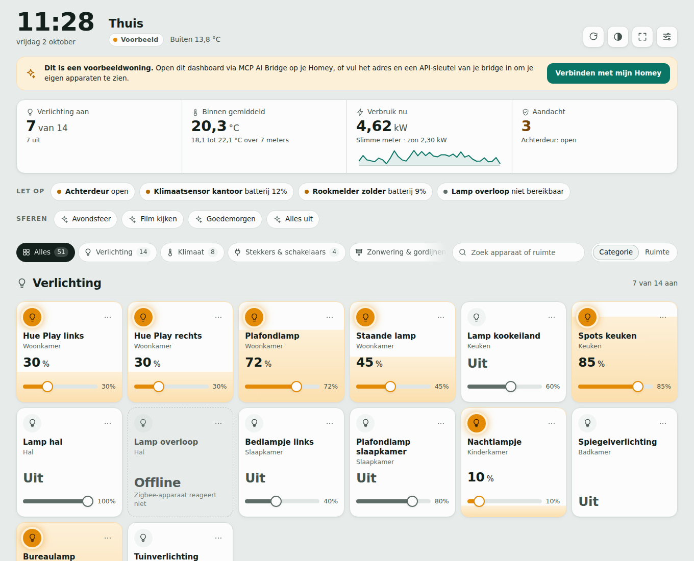
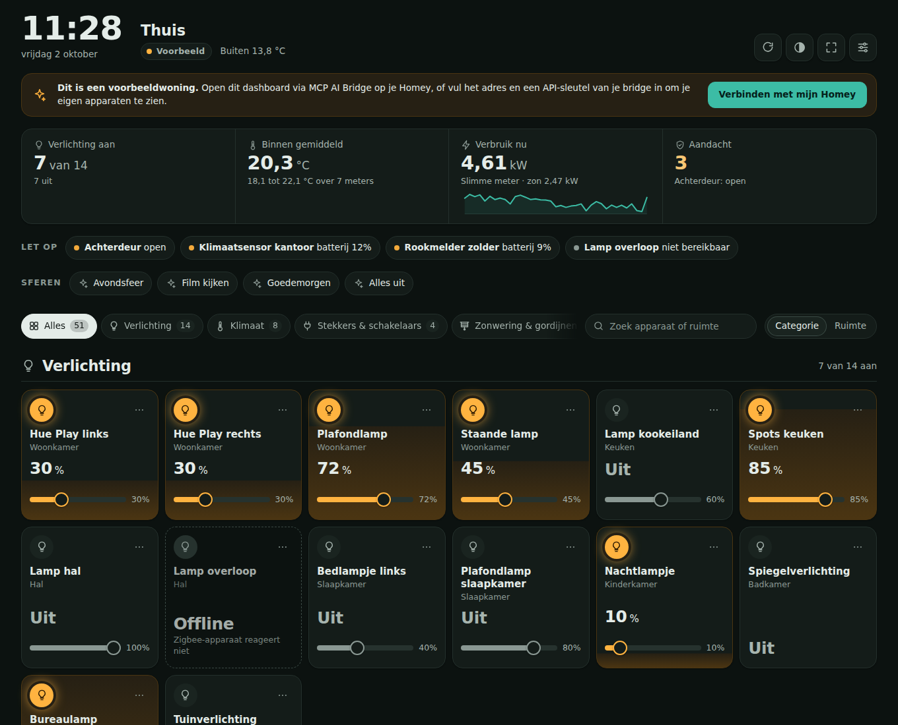
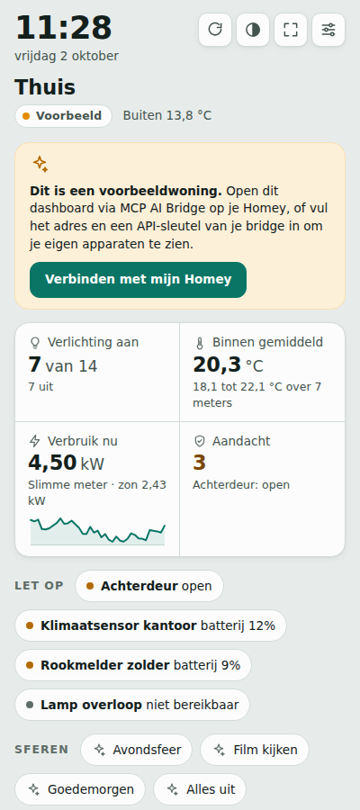

# Homey Dashboard voor MCP AI Bridge

Een live dashboard voor je Homey Pro dat draait binnen [MCP AI Bridge](https://homey.app/a/community.mcp-ai-bridge). Het haalt bij het openen al je apparaten op via de bridge, deelt ze in per categorie en laat je ze direct bedienen.



## Wat je krijgt

- **Al je apparaten, per categorie.** Verlichting, klimaat, stekkers en schakelaars, zonwering, media, beveiliging, sensoren, energie, huishouden en overig. Ook apparaten die niet bereikbaar zijn staan erin. Met één knop wissel je naar een indeling per ruimte.
- **Bediening op de tegel.** Tik om aan of uit te zetten, dim met de schuif, zet de thermostaat een halve graad hoger of lager, bedien rolluiken en media, schakel het alarmsysteem. Een slot open je met een tweede tik ter bevestiging.
- **Een lamp vult haar tegel met lamplicht** tot het niveau waarop ze gedimd staat. Je ziet in één blik welke lampen branden en hoe fel.
- **Overzicht bovenaan:** lampen aan, gemiddelde binnentemperatuur, actueel verbruik van de slimme meter met een lijn van de afgelopen minuten, opwek van de zonnepanelen en de buitentemperatuur.
- **Let op-balk** met open deuren, actieve alarmen, batterijen onder 15% en onbereikbare apparaten. Tik erop voor de details.
- **Sferen** (moods) als knoppen, als je bridge ze aanbiedt.
- **Alle gegevens van een apparaat** in een detailvenster, met elke capability, wanneer die voor het laatst veranderde en het apparaat-id.
- Zoeken op naam, ruimte of categorie, licht en donker thema, schermvullend met scherm-aan voor een wandtablet, en een indeling die op telefoon, tablet en groot scherm werkt.
- Eén HTML-bestand van ongeveer 170 KB, zonder afhankelijkheden.

| Donker | Telefoon |
| --- | --- |
|  |  |

## Meteen bekijken

Open `dist/homey-dashboard.html` in je browser. Zonder verbinding laat het dashboard een voorbeeldwoning zien, zodat je kunt rondkijken en alles kunt uitproberen.

## In MCP AI Bridge zetten

### 1. Maak twee API-sleutels

Open in de Homey-app de instellingen van MCP AI Bridge, tab **Security**:

| Sleutel | Permissie | Waarvoor |
| --- | --- | --- |
| `dashboard` | **Control only** | Voor het dashboard zelf: apparaten lezen en bedienen, sferen aanzetten. Kan niets verwijderen of omzetten. |
| `beheer` | **Control and change** | Eenmalig, om het dashboard op de bridge te zetten. |

Wil je de lijst met tools per sleutel inperken? Geef de `dashboard`-sleutel dan in elk geval de tools om apparaten op te halen, een capability te zetten, ruimtes op te halen en sferen op te halen en aan te zetten.

### 2. Zet het dashboard op de bridge

Kies één van de twee routes.

**A. Via je AI-assistent.** Open Claude Desktop, Claude Code of een andere assistent die met de bridge verbonden is in deze map en geef hem prompt 1 uit [PROMPT.md](PROMPT.md). De assistent zoekt de juiste dashboard-tool van de bridge en zet de pagina erop.

**B. Met het deployscript** (Node.js 18 of nieuwer, verder niets te installeren):

```bash
node scripts/deploy.mjs --url http://192.168.1.50:52199/mcp --key <beheer-sleutel> --name thuis --default --home "Thuis"
```

Met `--dry-run` zie je eerst wat er verstuurd wordt. Het script zoekt zelf de tool van de bridge die een eigen HTML-dashboard opslaat. Twijfelt het, dan toont het de dashboard-tools met hun velden en kies je er een met `--tool`.

### 3. Open het dashboard

Ga naar `http://<homey-ip>:52199/dashboard/thuis` (of `/dashboard` als je het standaard hebt gemaakt). Tik op **Verbinden met mijn Homey**, plak de `dashboard`-sleutel en sla op. De sleutel blijft alleen in die browser. Het adres van de bridge hoef je niet in te vullen; het dashboard weet waar het draait.

Hoef je op een wandtablet liever niets in te vullen? Zet de sleutel dan bij het plaatsen in de pagina met `--embed-key <dashboard-sleutel>`. Iedereen die de pagina op je netwerk opent, kan dan bedienen wat die sleutel toestaat. Dat is hetzelfde model als het eigen dashboard van de bridge, dat ook alleen op je thuisnetwerk werkt.

## Alternatief: op een eigen computer, NAS of Raspberry Pi

```bash
node scripts/serve.mjs --url http://192.168.1.50:52199/mcp --key <dashboard-sleutel> --host 0.0.0.0 --port 8080
```

Open daarna `http://<ip-van-die-computer>:8080`. De server stuurt de verzoeken door naar de bridge en zet de sleutel er zelf bij; de browser krijgt hem nooit te zien. Dit werkt ook als de bridge geen scripts toestaat in een eigen HTML-dashboard. Zonder `--url` toont het de voorbeeldwoning.

## Je eigen Homey controleren

```bash
node scripts/inspect.mjs --url http://192.168.1.50:52199/mcp --key <dashboard-sleutel>
```

Je ziet welke tools het dashboard gebruikt, hoeveel apparaten er per categorie zijn en welke apparaten in **Overig** belanden. Met `--json apparaten.json` schrijf je de ingelezen apparaten weg om ze te bekijken.

## Hoe apparaten worden ingedeeld

De indeling volgt de Homey-klasse van een apparaat. Heb je in Homey aangegeven dat een stekker een lamp is, dan telt die keuze. Sensoren en apparaten met klasse *other* worden ingedeeld naar wat ze kunnen.

| Categorie | Homey-klassen en capabilities |
| --- | --- |
| Verlichting | `light`, of iets met `dim`, `light_hue` of `light_temperature` |
| Klimaat | `thermostat`, `heater`, `radiator`, `airconditioning`, `fan`, `airpurifier`, `dehumidifier`, `humidifier`, `boiler`, `heatpump`, `fireplace`, `waterheater`, en sensoren die temperatuur, vocht, CO₂ of fijnstof meten |
| Stekkers & schakelaars | `socket`, `button`, `remote`, en overige apparaten met alleen `onoff` |
| Zonwering & gordijnen | `windowcoverings`, `blinds`, `curtain`, `sunshade`, `shutterblinds`, `awning` |
| Media | `speaker`, `tv`, `amplifier`, `mediaplayer`, `settopbox`, `gameconsole` |
| Beveiliging | `lock`, `homealarm`, `camera`, `doorbell`, `smokealarm`, `garagedoor`, en alles met `alarm_smoke`, `alarm_co` of `alarm_heat` |
| Sensoren | bewegings-, deur- en raamcontacten, waterlek- en trillingssensoren |
| Energie | `solarpanel`, `battery`, `evcharger`, `car`, de slimme meter, gas- en watermeters |
| Huishouden | wasmachine, droger, vaatwasser, stofzuiger, oven, koffiemachine, koelkast, grasmaaier en meer |
| Overig | alles wat nergens anders past |

Het verbruik bovenaan komt van je slimme meter als het dashboard die herkent (een cumulatieve energiemeter in Homey, of een naam als *P1* of *slimme meter*). Anders telt het het vermogen van je apparaten op. Sensoren met *buiten*, *tuin*, *terras* of *balkon* in hun naam of ruimte tellen niet mee voor de binnentemperatuur; de eerste daarvan staat als buitentemperatuur naast de naam van je huis.

## Hoe het werkt

Het dashboard praat met het `/mcp`-endpoint van de bridge, net als je AI-assistent: JSON-RPC volgens het Model Context Protocol (Streamable HTTP, met sessies en SSE). Bij het verbinden vraagt het de tools op en kiest het zelf de tools voor apparaten, bediening, ruimtes en sferen. Het herkent ze aan hun naam en hun invoerschema, zodat het blijft werken als de bridge een tool hernoemt of extra velden krijgt.

De eerste keer haalt het de uitgebreide apparatenlijst op, inclusief eenheden, grenzen en wat bedienbaar is, over alle pagina's heen. Daarna ververst het elke 10 seconden met de compacte lijst (instelbaar), en elke vijf minuten weer met de uitgebreide lijst, samen met de ruimtes en sferen. Staat het tabblad op de achtergrond, dan wacht het.

Een bediening is direct zichtbaar. Lukt de opdracht niet, dan springt de tegel terug en zie je de melding van de bridge.

## Problemen oplossen

| Je ziet | Wat er aan de hand is |
| --- | --- |
| **Geen verbinding** met *401* | De API-sleutel ontbreekt of klopt niet. Vul hem in bij Instellingen. |
| **Geen verbinding** met *403* | De bridge weigert: kijk naar de toegangsmodus (staat de bridge op *off* of *read only*?), de IP-whitelist en de toolkeuze van de sleutel op de Security-tab. Het securitylog daar noemt de reden. |
| *Geen tool om apparaten op te halen* | De sleutel mag de apparaten-tool niet zien. Pas de toolkeuze van de sleutel aan. |
| De pagina op `/dashboard/thuis` is leeg, of knoppen en klok doen niets | De bridge staat in een eigen HTML-dashboard waarschijnlijk geen scripts toe. Gebruik prompt 2 uit [PROMPT.md](PROMPT.md) voor dezelfde indeling in de modus van de bridge zelf, of draai `scripts/serve.mjs`. |
| *Voorbeeld* terwijl je het dashboard vanaf je computer opent | Een pagina op een ander adres dan de bridge mag de bridge meestal niet bereiken. Open het via de bridge of via `scripts/serve.mjs`. |
| Een apparaat staat in de verkeerde categorie | Geef het in Homey de juiste klasse (bij een stekker: *Wat is aangesloten?*). `scripts/inspect.mjs` laat zien wat het dashboard ziet. |

## Ontwikkelen

```text
src/
  index.html   sjabloon met iconen en dialogen
  styles.css   vormgeving, licht en donker
  core.js      indelen, samenvatten, tools herkennen (zonder DOM)
  mcp.js       MCP-client voor browser en Node
  demo.js      voorbeeldwoning
  app.js       de interface
scripts/
  build.mjs    voegt src/ samen tot dist/homey-dashboard.html
  deploy.mjs   zet het dashboard op de bridge
  serve.mjs    lokale server met doorgifte naar de bridge
  inspect.mjs  laat zien wat het dashboard van je Homey ziet
test/          unit-tests en een nagebootste bridge
```

```bash
npm run build   # dist/homey-dashboard.html opnieuw maken
npm test        # tests, inclusief deploy en inspect tegen de nagebootste bridge
node test/fake-bridge.mjs 52199   # nagebootste bridge om tegen te ontwikkelen (sleutel: test-key)
```

Er zijn geen npm-pakketten nodig. Lettertypen komen van Google Fonts; zonder internet valt het dashboard terug op de systeemletters.
